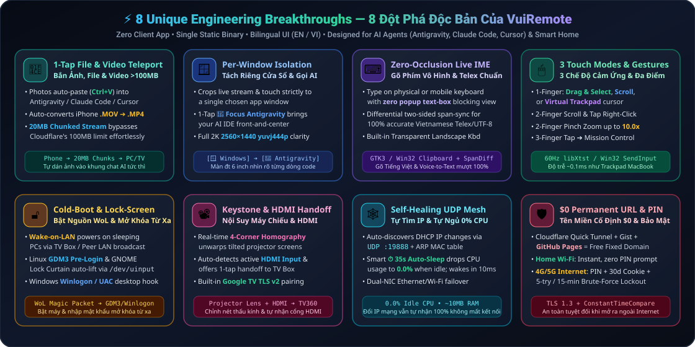

# VuiRemote 📺💻📽️🚀

[](#-english-documentation)
[](AGENTS.md)
[](#supported-operating-systems--devices)
[](#supported-operating-systems--devices)
[](#free-permanent-internet-url-4g5g--3-layer-zero-trust-security)
[](LICENSE)

<p align="center">
  <b><a href="#-english-documentation">🇺🇸 Read in English</a></b> &nbsp;•&nbsp;
  <b><a href="#-tài-liệu-tiếng-việt-vietnamese-documentation">🇻🇳 Đọc bản Tiếng Việt</a></b> &nbsp;•&nbsp;
  <b><a href="https://github.com/mrtrinhvn/VuiRemote/raw/main/docs/videos/VuiRemote_TikTok_Shorts_9x16.mp4">📱 Tải Clip TikTok (9:16)</a></b> &nbsp;•&nbsp;
  <b><a href="https://github.com/mrtrinhvn/VuiRemote/raw/main/docs/videos/VuiRemote_YouTube_16x9.mp4">🖥️ Tải Clip YouTube (16:9)</a></b>
</p>

<p align="center">
  
</p>

<p align="center">
  
</p>

---

# 🇺🇸 English Documentation

**VuiRemote** is an ultra-lightweight, **Zero-Client-App, AI-Agent-Native Multi-Device Remote Hub** written in **100% pure Go (standard library)** with native C/Win32/uinput bridges. It lets you control your entire home ecosystem (**Windows PCs, Linux Workstations, Android TV Boxes, Smart Projectors**) and pair-program remotely with **AI Coding Agents (Google Antigravity, Claude Code, OpenAI Codex, Cursor)** from **a single mobile browser tab** — over home Wi-Fi or 4G/5G anywhere in the world.

> ⭐ **If you find VuiRemote useful, please give this repository a Star at the top-right of GitHub to support the project and help more developers discover it!**

---

## 🔥 Why VuiRemote Is Unlike Any Other Remote Desktop Tool

Traditional remote desktop tools (TeamViewer, AnyDesk, RustDesk, VNC) require heavy client apps on every phone, struggle with mobile touch ergonomics, choke on non-ASCII/IME input, and flatten a massive 2K/4K desktop onto a tiny phone screen. **VuiRemote** was engineered from first principles for **mobile-to-AI-Agent workflows and smart-home control**:

### 1. 📎 1-Tap Mobile-to-PC File, Photo, Audio & 100MB+ Video Teleport
- **Instant Clipboard Image Injection (`Ctrl+V`)**: Tap **`📎 File`** on your phone, pick a screenshot or camera photo, and VuiRemote automatically converts it to PNG, injects it directly into the remote PC's native system clipboard (`GTK3` on Linux / `SetClipboardData` on Windows), and triggers **`Ctrl+V`** — dropping the image straight into your active **Antigravity / Claude Code / Cursor** chat box!
- **Automatic iPhone `.MOV` ➔ `.MP4 (H.264/AAC)` Transcoding**: Shooting a bug reproduction video on an iPhone? VuiRemote automatically transcodes Apple `.MOV (HEVC)` recordings into universal `.MP4 (H.264 + AAC)` via `ffmpeg` on the fly and pastes the file path directly into your AI Agent prompt or terminal.
- **Unlimited Size via `20MB` Chunked Streaming**: Automatically slices large videos and archives into `20MB` sequential chunks, cleanly bypassing Cloudflare Quick Tunnel's `100MB` HTTP body limit with a live `0%–100%` progress indicator.

### 2. 🪟 Per-Window Stream Isolation & 1-Tap `🚀 Focus Antigravity`
- Trying to read a 2560×1440 desktop on a 6-inch phone screen is painful. Tap **`🪟 Windows`** on VuiRemote's top bar to list every open application window on your Linux or Windows PC.
- Pick any window — or tap **`🚀 Focus Antigravity`** — and VuiRemote **crops the live video stream and remaps 100% of your touch coordinates strictly to that single window**, turning your phone into a dedicated mobile screen for your IDE.

### 3. ⌨️ Zero-Occlusion Live IME Bridge & Transparent Landscape Keyboard
- **No Blocking Text Boxes**: Type on a physical keyboard, mobile soft keyboard, or mobile **Voice-to-Text microphone** while watching the live screen with **zero popup input box blocking your view**.
- **Differential Two-Sided Span-Sync**: Solves the notorious mobile IME composition bug (Vietnamese Telex/VNI, CJK, autocorrect). When your phone's IME replaces a word or adds diacritics, VuiRemote computes the exact prefix/suffix character diff, sends the exact count of `Backspaces`, and injects the updated UTF-8 characters via a persistent RAM-backed clipboard daemon (`~0.5ms` latency).
- **Built-in Transparent Landscape Keyboard**: Includes an on-screen transparent QWERTY + Vietnamese Telex keyboard that overlays cleanly in landscape without shrinking the video canvas.

### 4. 🖱️ 3 Smart 1-Finger PC Touch Modes + MacBook-Grade Multi-Touch Gestures
- **1-Tap Mode Switcher (`🖱️ 1F: Drag` / `👆 1F: Scroll` / `🎯 1F: Trackpad`)**:
  - **Drag & Select Mode**: 1-finger drag highlights text, moves windows, or drags sliders in real time (`60Hz` via `libXtst` / `Win32 SendInput`).
  - **Standard Touch Mode**: Tap = Left-click, Double-tap = Double-click, Long-press (`0.4s`) = Right-click, Long-press + Drag = Drag & Drop.
  - **Virtual Trackpad Mode**: Relative cursor movement with ballistic acceleration for pixel-perfect clicking.
- **Multi-Touch Gestures**:
  - **2-Finger Parallel Swipe**: Smooth 4-direction scrolling (`Up / Down / Left / Right`) right at the cursor position.
  - **2-Finger Tap**: Instant Right-Click.
  - **2-Finger Pinch / Spread**: Up to **`10.0x` Zoom** rendered at native **2K (`2560×1440`) `yuvj444p` (4:4:4 chroma, zero color subsampling)** so every line of code stays razor-sharp.
  - **3-Finger Tap**: Opens macOS/GNOME/Windows **Mission Control / Window Overview (`Super` key)**.

### 5. 🔓 Cold-Boot Wake-on-LAN & Lock-Screen Unlocking (`GDM3` / `Winlogon`)
- **Remote Power-On (`⚡ Wake-on-LAN`)**: Even if your PC is completely powered off or suspended, a lightweight always-on Android TV Box (consuming just `~3W`) or LAN peer broadcasts a `Wake-on-LAN` Magic Packet (`UDP :9` / `:7`) to boot your PC remotely.
- **Linux GDM3 Pre-Login & GNOME Lock Curtain Bypass**: Includes a systemd-integrated `GDM3 Xauthority` bridge and kernel `/dev/uinput` virtual keyboard that automatically lifts the GNOME lock curtain and types your password at the login screen before any user session even starts.
- **Windows `Winlogon` & UAC Secure Desktop Hook**: Uses `OpenInputDesktop` + `SwitchInputDesktop` in `platform_windows.go` so you can see and type into the Windows 10/11 Lock Screen and UAC elevation prompts remotely.

### 6. 📽️ Smart Projector 4-Corner Keystone Homography & Auto HDMI Handoff
- **8-Parameter Perspective Dewarping**: Reads the 4-corner hardware keystone calibration of smart Android projectors and applies an inverse homography matrix so an angled projector image appears flat (`16:9`) on your phone, and touching any button maps back to the exact warped pixel.
- **Projector Hardware Controls**: Adjust motorized lens focus (`Focus + / - / Auto`), Keystone, Zoom, or **Mute Screen (Audio-Only Mode)** to listen to music with the projector lamp turned off.
- **Automatic HDMI Source Detection & 1-Tap Handoff**: Automatically detects when a projector is displaying an external HDMI input (e.g., `HDMI 2 — Viettel TV360 Box`) and displays a floating pill (**`Switch to TV360 Control ➔`**) plus built-in **Android TV / Google TV Remote TLS v2 Pairing (`port 6466/6467`)**.

### 7. 🕸️ Self-Healing Zero-Config UDP Mesh (`:19888`) & `⏱ 35s` Zero-CPU Sleep
- **Automatic DHCP IP Discovery**: Every node broadcasts its identity and MAC address on `UDP :19888` and cross-checks the kernel ARP table (`/proc/net/arp`). Even if your router reassigns all LAN IPs after a power outage, VuiRemote reconnects every device automatically.
- **Smart `⏱ 35s` Auto-Sleep Stream**: Drops screen capture CPU usage to **`0.0%`** after 35 seconds of inactivity or when you lock your phone/switch browser tabs, and wakes up in **`10ms`** the instant you touch the screen (or switch to `♾️ Live` continuous mode anytime).

### 8. 🌐 Built-in Bilingual Interface (`🌐 EN / VI`)
- Automatically detects your browser language (`English` for international users, `Tiếng Việt` for Vietnamese users) and provides a **1-tap `🌐 EN / VI` toggle button** right on the top bar and PIN lock screen.

---

## 📋 Supported Operating Systems & Devices

No client app is ever needed on your phone or tablet (works in Safari on iOS/iPadOS and Chrome/Firefox/Edge on Android/Desktop). On target devices, **VuiRemote** runs as a single dependency-free binary:

| Device Category | Supported OS Versions | Deployment & Key Capabilities |
| :--- | :--- | :--- |
| 🪟 **Windows PCs**<br>*(Desktop, Laptop, Mini PC NUC/Beelink, Surface)* | • **Windows 11** *(Home, Pro, Enterprise, IoT / LTSC — 21H2, 22H2, 23H2, 24H2)*<br>• **Windows 10** *(Home, Pro, LTSC — 64-bit 1809 to 22H2)*<br>• **Windows 8.1 (64-bit)**<br>• **Windows Server 2016 / 2019 / 2022 / 2025** *(Desktop Experience)* | • Single standalone **`vuiremote-windows-amd64.exe` (`~6.6MB`)** — zero installer, zero `.NET` or `VC++` runtime required.<br>• Per-Monitor DPI Awareness (`100%`–`250%`), `Winlogon` lock-screen support, per-window isolation, and **Wake-on-LAN**. |
| 🐧 **Linux Workstations**<br>*(PC, Laptop, Home Server, Raspberry Pi)* | • **Ubuntu** *(20.04, 22.04, 24.04 LTS)* & **Pop!_OS**<br>• **Linux Mint, Debian, Kali Linux, Zorin OS**<br>• **Fedora, RHEL, AlmaLinux, Rocky Linux**<br>• **Arch Linux, Manjaro, EndeavourOS** | • Includes **GDM3 Pre-Login Bridge** to view and unlock the Linux login/lock screen remotely.<br>• True **`yuvj444p` (4:4:4)** chroma capture + `libXtst` 60Hz input + GTK3 persistent clipboard daemon. |
| 📺 **Android TV & Set-Top Boxes**<br>*(Carrier & Retail Boxes)* | • **Android 5.0 to Android 14 / Google TV** *(both 32-bit `ARMv7` and 64-bit `ARM64`)*<br>• **Tanix TX3 Mini / TX3 Max, X96, Mecool, H96**<br>• **Xiaomi Mi Box S, Chromecast with Google TV, Nvidia Shield, Sony/TCL/Casper TVs, Viettel TV360** | • Registers persistent kernel virtual input devices (`/dev/uinput`: `VuiTouch`, `VuiMouse`, `VuiKeyboard`) for **`12ms`** zero-lag control.<br>• Acts as an always-on **`3W` LAN Hub** to send **Wake-on-LAN** packets to wake sleeping PCs. |
| 📽️ **Smart Projectors**<br>*(Android TV / AOSP Projectors)* | • **KAW A70 Pro, Hyundai, Wanbo, XGIMI, Beecube, Eroc...** | • Real-time **4-Corner Hardware Keystone Dewarping**, motorized lens focus (`Focus +/-`), screen mute, and automatic HDMI input handoff. |

---

## 🛡️ Free Permanent Internet URL (4G/5G) & 3-Layer Zero-Trust Security

Unlike tools that require paid relays or risky router port-forwarding (which fails behind ISP CGNAT), **VuiRemote** includes a **$0/month Permanent URL + Zero-Trust Security** architecture:

<p align="center">
  
</p>

1. **How the Free Permanent Domain (`https://<your-name>.github.io/vui`) Works**:
   - **Cloudflare Quick Tunnel (`trycloudflare.com`)** creates a free outbound TLS 1.3 tunnel through any NAT/firewall with zero router configuration. Because free Quick Tunnels generate a new random URL after a power outage or reboot, VuiRemote's built-in `syncTunnelURLToGist()` daemon automatically pushes the new `.trycloudflare.com` URL to your private **GitHub Gist** ([`configs/vui_gist_sync.example.json`](configs/vui_gist_sync.example.json)).
   - Your static **GitHub Pages** redirect ([`configs/github_pages_redirect.html`](configs/github_pages_redirect.html)) at `https://<your-name>.github.io/vui` fetches that Gist and redirects your phone to the live tunnel in `0.5s`. Bookmark it once on your phone's Home Screen and use it forever!
2. **3-Layer Zero-Trust Security**:
   - **Unique Per-Machine Cryptographic PIN**: On first launch, VuiRemote uses `crypto/rand` to generate a unique 4-digit PIN stored locally at `~/.config/vuiremote/pin.txt` (`chmod 0600`, never committed to Git).
   - **Context-Aware Authentication**:
     - 🏠 **Home Wi-Fi (Private LAN)**: Opens instantaneously with zero PIN prompt.
     - 🌍 **Internet (4G/5G / Cloudflare Tunnel)**: Strictly enforces the 4-digit PIN before loading the UI or executing any API call, issuing a 30-day `HttpOnly` `SHA-256` signed session cookie.
   - **Anti-Brute-Force Lockout**: Verifies PINs using `crypto/subtle.ConstantTimeCompare` and automatically blocks any remote IP for **15 minutes** (`HTTP 429`) after 5 failed attempts.

---

## 💻 Built-In Bilingual CLI (`vuiremote` CLI)

```text
$ vuiremote status
╔══════════════════════════════════════════════════════════════════╗
║           📡 VUIREMOTE SYSTEM STATUS / TRẠNG THÁI HỆ THỐNG       ║
╚══════════════════════════════════════════════════════════════════╝
  🏠 Home LAN URL (Wi-Fi)        : http://192.168.1.154:8090 (PIN-free / Miễn hỏi PIN)
  📌 Permanent 4G URL            : https://<username>.github.io/vui
  🌐 Direct Cloudflare URL       : https://xxxx-yyyy.trycloudflare.com
  🔑 Internet Security PIN       : 4928 (Brute-force lock: 15m after 5 tries)
  📂 Device Registry File        : ~/.config/vuiremote/devices.json (6 devices)
```

| CLI Command | Description |
| :--- | :--- |
| `vuiremote status` | Show LAN IP, active Cloudflare 4G URL, permanent GitHub Pages URL, and Security PIN |
| `vuiremote tunnel start` | Start a free background **Cloudflare Quick Tunnel** and auto-sync to GitHub Gist |
| `vuiremote pin` | Display your current 4-digit Internet security PIN |
| `vuiremote pin 6868` | Set a custom 4-digit security PIN |
| `vuiremote pin --regen` | Generate a new random 4-digit security PIN |
| `vuiremote devices` | List all configured devices in `devices.json` |

---

## 🤖 100% Autonomous Deployment via AI Agents (Antigravity / Claude Code / Codex)

VuiRemote is built **AI-Agent Native** with [`AGENTS.md`](AGENTS.md), [`CLAUDE.md`](CLAUDE.md), and the [`.agents/skills/vuiremote-deploy/SKILL.md`](.agents/skills/vuiremote-deploy/SKILL.md) skill. Just paste this prompt into **Google Antigravity**, **Claude Code**, **OpenAI Codex**, or **Cursor**:

> 💬 **First-Time Autonomous Setup Prompt:**
> *"Clone `https://github.com/mrtrinhvn/VuiRemote`, read `AGENTS.md` and `.agents/skills/vuiremote-deploy/SKILL.md`, scan my local network, and autonomously build and deploy VuiRemote for this computer and my Android TV / Projector devices."*

> 💬 **Enable Free 4G/5G Permanent URL Prompt:**
> *"Start a free Cloudflare Tunnel for VuiRemote and configure automatic sync to my GitHub Gist + GitHub Pages (`vui`) using the templates in `configs/` so I can control my PC and Antigravity from my phone over 4G/5G."*

---
---

# 🇻🇳 Tài Liệu Tiếng Việt (Vietnamese Documentation)

**VuiRemote** là hệ thống điều khiển từ xa đa thiết bị siêu nhẹ (**Zero-Latency, Zero-Client-App Multi-Device Web Remote Hub**) viết bằng **Go (Golang)** thuần kết hợp cầu nối phần cứng thực (`libXtst`, `Win32 SendInput`, `Linux /dev/uinput`). Công cụ cho phép bạn điều khiển toàn bộ thiết bị trong gia đình (**Máy tính Windows, Linux, Android TV Box, Máy chiếu thông minh**) **và làm việc từ xa với các AI Agent (Google Antigravity, Claude Code, OpenAI Codex, Cursor)** chỉ từ **một tab trình duyệt duy nhất trên điện thoại** — dù đang ở nhà hay đi ra ngoài dùng 4G/5G.

> ⭐ **Nếu thấy VuiRemote hữu ích, hãy tặng dự án 1 ngôi sao (Star) ở góc trên bên phải GitHub để ủng hộ mình (`mrtrinhvn`) và giúp nhiều người biết đến hơn nhé!**

---

## 🎬 Video Giới Thiệu Nhanh (Bản Dọc TikTok `9:16` & Bản Ngang YouTube `16:9`)

Mình đã dựng sẵn 2 bản video thuyết minh đầy đủ tính năng của **VuiRemote** (lưu trực tiếp trong repo tại thư mục [`docs/videos/`](docs/videos/)):
- 📱 **Bản dọc `9:16` (`1080×1920` — TikTok / YouTube Shorts / Reels)**: [**Xem / Tải trực tiếp `VuiRemote_TikTok_Shorts_9x16.mp4`**](https://github.com/mrtrinhvn/VuiRemote/raw/main/docs/videos/VuiRemote_TikTok_Shorts_9x16.mp4)
- 🖥️ **Bản ngang `16:9` (`1920×1080` — YouTube Full HD / Website)**: [**Xem / Tải trực tiếp `VuiRemote_YouTube_16x9.mp4`**](https://github.com/mrtrinhvn/VuiRemote/raw/main/docs/videos/VuiRemote_YouTube_16x9.mp4)

---

## 🔥 8 Đột Phá Công Nghệ Tạo Nên Sự Khác Biệt Của VuiRemote

Các phần mềm điều khiển từ xa truyền thống (TeamViewer, AnyDesk, UltraViewer, VNC) vốn được thiết kế cho màn hình máy tính: bắt phải cài App nặng nề lên điện thoại, nhòe chữ khi đọc code, hay bị lỗi bộ gõ Tiếng Việt và rất bất tiện khi phải nhìn toàn bộ màn hình Desktop rộng lớn trên màn hình điện thoại nhỏ. **VuiRemote** giải quyết triệt để bằng **8 công nghệ độc bản**:

### 1. 📎 Bắn Trực Tiếp Ảnh, Tệp Tin, Âm Thanh & Video `>100MB` Từ Điện Thoại Vào Thẳng AI Agent
- **Tự động dán ảnh (`Ctrl+V`) vào khung chat AI**: Chỉ cần bấm nút **`📎 Tệp`** trên thanh đầu (hoặc trong hộp phím), chọn ảnh chụp màn hình hoặc chụp ảnh trực tiếp bằng Camera điện thoại — VuiRemote tự động chuyển sang PNG, nạp thẳng vào Clipboard hệ thống của máy tính từ xa và **bấm sẵn `Ctrl+V`** để ảnh hiện ngay trong khung chat **Antigravity / Claude Code / Cursor**!
- **Tự động chuyển đổi Video quay màn hình iPhone (`.MOV` ➔ `.MP4 H.264/AAC`)**: Khi gửi video `.MOV` quay từ iPhone/iPad, máy chủ VuiRemote tự động nén chuẩn `.MP4 (H.264 + AAC)` bằng `ffmpeg` và dán sẵn đường dẫn file vào cửa sổ làm việc.
- **Cắt nhỏ luồng truyền `20MB/chunk` vượt giới hạn Cloudflare**: Tự động chia các file video/tài liệu nặng hàng trăm MB thành từng gói `20MB` nối tiếp nhau kèm thông báo tiến độ `0%–100%`, vượt qua hoàn toàn giới hạn `100MB` của Cloudflare Tunnel miễn phí.

### 2. 🪟 Tách Riêng Từng Cửa Sổ Làm Việc (`Window Picker`) & Nút `🚀 Gọi Antigravity`
- Thay vì phải căng mắt nhìn cả màn hình Desktop nhiều cửa sổ chồng chéo trên màn hình điện thoại 6 inch, hãy bấm nút **`🪟 Cửa sổ`** trên thanh công cụ:
  - Chọn bất kỳ ứng dụng nào đang mở (Chrome, Terminal, VS Code...) hoặc bấm **`🚀 Gọi Antigravity`**.
  - VuiRemote sẽ **cắt riêng hình ảnh của đúng cửa sổ đó phát lên toàn màn hình điện thoại** và tự động ánh xạ 100% tọa độ chạm/vuốt vào đúng cửa sổ đó!

### 3. ⌨️ Gõ Phím Vô Hình Không Che Màn Hình (`Zero-Occlusion IME`) & Bàn Phím Ngang Telex Trong Suốt
- **Gõ trực tiếp không cần ô nhập che khuất**: Dù bạn gõ bằng bàn phím cứng, bàn phím ảo điện thoại hay đọc **Giọng nói tiếng Việt (Voice-to-Text)**, chữ sẽ xuất hiện trực tiếp tại vị trí con trỏ trên máy tính mà **không có bất kỳ hộp thoại nhập chữ nào che khuất màn hình**.
- **Thuật toán đồng bộ vi sai 2 đầu (`Two-Sided Span-Diff`)**: Giải quyết triệt để lỗi nuốt chữ/nhảy dấu khi gõ Tiếng Việt Telex/VNI trên điện thoại. Khi bộ gõ điện thoại tự gom chữ để bỏ dấu, VuiRemote tính chính xác số ký tự thay đổi, gửi lệnh xóa lùi và bơm chuỗi UTF-8 mới qua tiến trình **GTK3 / Win32 Clipboard Daemon** thường trực trên RAM chỉ trong `0.5ms`.
- **Bàn phím cảm ứng ngang trong suốt tích hợp sẵn**: Tích hợp bộ gõ **Tiếng Việt Telex** ngay trên bàn phím ảo ngang trong suốt để vừa nhìn toàn bộ màn hình vừa gõ phím cực nhanh.

### 4. 🖱️ 3 Chế Độ Cảm Ứng 1 Ngón Trên PC + Cử Chỉ Đa Điểm Như Trackpad MacBook
- **Nút chuyển nhanh 3 chế độ 1 ngón (`🖱️ 1Ngón: Kéo thả` / `👆 Cảm ứng chuẩn` / `🎯 1Ngón: Bàn rê`)**:
  - **Kéo thả trực tiếp (`Drag & Select`)**: Rê 1 ngón để bôi đen văn bản, kéo cửa sổ hoặc kéo thanh trượt theo thời gian thực ở tốc độ phần cứng `60Hz`.
  - **Cảm ứng chuẩn (`Scroll`)**: Chạm 1 lần = Click trái; Chạm đúp = Double-Click; Giữ `0.4s` = Chuột phải; Giữ `0.4s` rồi kéo = Kéo thả.
  - **Bàn rê chuột (`Trackpad`)**: Điều khiển con trỏ chuột tương đối có gia tốc mượt mà.
- **Cử chỉ đa điểm 2 & 3 ngón**:
  - **Vuốt 2 ngón song song**: Cuộn trang mượt mà 4 chiều (`Lên / Xuống / Trái / Phải`) ngay tại vị trí con trỏ.
  - **Chạm 2 ngón cùng lúc**: Click **Chuột phải** tức thì.
  - **Chụm / Tách 2 ngón (`Pinch Zoom`)**: Phóng to lên tới **`10.0x`** trên nền ảnh gốc **2K (`2560×1440`) chuẩn màu `yuvj444p` (4:4:4 không nén màu)** giúp chữ code nhỏ nhất vẫn nét căng.
  - **Chạm 3 ngón**: Mở màn hình Đa nhiệm / Overview cửa sổ (`Phím Super / Windows`).

### 5. 🔓 Bật Nguồn Máy Tính Từ Xa (`Wake-on-LAN`) & Mở Khóa Màn Hình Đăng Nhập (`GDM3` / `Winlogon`)
- **Đánh thức PC đang tắt (`⚡ Wake-on-LAN`)**: Ngay cả khi máy tính ở nhà đang tắt nguồn hoặc ngủ (Suspend), chiếc Android TV Box chạy 24/7 (chỉ tốn `~3W` điện) sẽ phát xung `Magic Packet` qua mạng LAN để bật nguồn máy tính từ xa.
- **Vượt màn hình khóa Linux (`GDM3 Pre-Login Bridge` & `/dev/uinput`)**: Tự động hất mở rèm khóa GNOME (Lock Curtain) và cho phép nhìn thấy, nhập mật khẩu đăng nhập ngay từ màn hình khóa Linux trước khi vào Desktop.
- **Hỗ trợ màn hình khóa Windows (`Winlogon` & `UAC`)**: Tự động chuyển ngữ cảnh sang `Winlogon` desktop trên Windows 10/11 để bạn nhập mật khẩu mở khóa máy tính từ xa.

### 6. 📽️ Nội Suy Phối Cảnh 4 Góc Máy Chiếu (`Keystone Homography`) & Tự Nhận Cổng HDMI
- **Nắn phẳng hình máy chiếu nghiêng & Chạm chuẩn từng pixel**: Tự động đọc thông số 4 góc Keystone phần cứng của máy chiếu thông minh (KAW, Hyundai...) và tính ma trận nghịch đảo 8 tham số để hiển thị khung hình phẳng 16:9 trên điện thoại; chạm vào đâu trên điện thoại là trúng chính xác điểm đó trên màn chiếu.
- **Chỉnh thấu kính & Tắt hình nghe nhạc**: Điều khiển mô-tơ lấy nét (`Lấy nét + / - / Auto`), thu phóng màn chiếu và tắt đèn hình để nghe nhạc tiết kiệm tuổi thọ bóng chiếu.
- **Tự động phát hiện nguồn HDMI ngoài (`HDMI ➔ TV360`)**: Khi máy chiếu đang phát tín hiệu từ đầu thu HDMI ngoài (như Viettel TV360 Box), VuiRemote tự hiện nhãn nhắc và nút **1 chạm chuyển sang điều khiển đầu thu đó**, tích hợp sẵn giao thức ghép nối **Google TV Remote TLS v2 (`cổng 6466/6467`)**.

### 7. 🕸️ Mạng Lưới Tự Chữa Lành (`Zero-Config UDP Mesh :19888`) & Tự Ngủ `⏱ 35s` (`0% CPU`)
- **Đổi IP mạng vẫn tự tìm thấy nhau 100%**: Các thiết bị tự động phát bản tin định danh qua `UDP :19888` kết hợp đối chiếu bảng địa chỉ vật lý `ARP MAC`. Dù cục phát Wi-Fi khởi động lại và cấp IP mới cho toàn bộ thiết bị trong nhà, VuiRemote vẫn tự động cập nhật IP mới ngay lập tức.
- **Tự động tạm nghỉ sau `35s` không tương tác (`0% CPU`)**: Khi bạn không chạm vào màn hình 35 giây hoặc tắt màn hình điện thoại, luồng chụp màn hình tự động ngủ đông đưa mức tải CPU về **`0.0%`**, và thức dậy ngay tức thì trong **`10ms`** ngay khi bạn chạm tay lại (có nút đổi nhanh sang **`♾️ Liên tục`** nếu muốn vừa xem vừa theo dõi trực tiếp).

### 8. 🌐 Giao Diện & CLI Song Ngữ Tự Động (`🌐 VI / EN`)
- Tự động nhận diện ngôn ngữ trình duyệt (Tiếng Việt cho người Việt, Tiếng Anh cho người dùng quốc tế) và có nút **`🌐 VI / EN`** ngay trên thanh đầu để chuyển đổi ngôn ngữ chỉ với 1 chạm.

---

## ☕ Ra Ngoài Đường Vẫn Làm Việc Với Máy Tính & AI Agent (Antigravity / Claude Code / Codex)

<p align="center">
  
</p>

1. **Đánh thức & Mở khóa PC từ xa**: Mở VuiRemote trên điện thoại (qua 4G/5G), chạm **`⚡ Bật nguồn (Wake-on-LAN)`** và nhập mật khẩu mở khóa màn hình đăng nhập **Windows 10/11 / Linux GDM3**.
2. **Nút bấm chuyên dụng `🪟 Cửa sổ -> 🚀 Gọi Antigravity`**: Chỉ 1 chạm là cửa sổ **Antigravity / IDE** được tách riêng và hiển thị sắc nét toàn màn hình điện thoại.
3. **Đính kèm Ảnh / Video lỗi trực tiếp (`📎 Tệp`)**: Chụp ảnh hoặc quay màn hình trên điện thoại gửi thẳng vào khung chat của AI Agent mà không cần qua Zalo/Telegram trung gian.
4. **Ra lệnh bằng Giọng nói / Gõ Tiếng Việt có dấu**: Bấm nút Micro trên bàn phím điện thoại đọc thẳng yêu cầu bằng tiếng Việt để giao việc tiếp cho AI Agent làm việc ở nhà!

---

## 📋 Danh Sách Hệ Điều Hành & Thiết Bị Hỗ Trợ

| Nhóm thiết bị | Hệ điều hành & Phiên bản hỗ trợ cụ thể | Đặc điểm triển khai & Tính năng nổi bật |
| :--- | :--- | :--- |
| 🪟 **Máy tính Windows**<br>*(PC để bàn, Laptop, Mini PC NUC/Beelink, Surface)* | • **Windows 11** *(Home, Pro, Enterprise, IoT / LTSC — 21H2, 22H2, 23H2, 24H2)*<br>• **Windows 10** *(Home, Pro, LTSC — mọi bản 64-bit từ 1809 đến 22H2)*<br>• **Windows 8.1 (64-bit)**<br>• **Windows Server 2016 / 2019 / 2022 / 2025** *(bản có giao diện Desktop)* | • Chạy độc lập **1 file `.exe` duy nhất (`~6.6MB`)**, **không cần cài đặt**, không cần `.NET` hay `VC++` phụ thuộc.<br>• Tự nhận diện tỉ lệ DPI (`100%`–`250%`), màn hình `FullHD / 2K / 4K`, tách riêng cửa sổ **Antigravity / Claude Code** và hỗ trợ **Wake-on-LAN** bật máy từ xa. |
| 🐧 **Máy tính Linux**<br>*(PC, Laptop, Workstation, Mini Server, Raspberry Pi)* | • **Ubuntu** *(20.04, 22.04, 24.04 LTS)* & **Pop!_OS**<br>• **Linux Mint, Debian, Kali Linux, Zorin OS**<br>• **Fedora, RHEL, AlmaLinux, Rocky Linux**<br>• **Arch Linux, Manjaro, EndeavourOS** | • Tích hợp cầu nối **GDM3 Pre-Login Bridge** cho phép nhìn thấy và **nhập mật khẩu mở khóa thẳng từ màn hình khóa Linux**.<br>• Truyền hình ảnh chuẩn màu **`yuvj444p` (4:4:4)** siêu nét không nhòe chữ khi đọc code trên điện thoại. |
| 📺 **Android TV & TV Box**<br>*(Box nhà mạng & Box quốc tế)* | • **Android 5.0 đến Android 14 / Google TV** *(cả chip 32-bit `ARMv7` và 64-bit `ARM64`)*<br>• **Tanix TX3 Mini / TX3 Max, X96, Mecool, H96**<br>• **Viettel TV360 Box, FPT Play Box, MyTV Box**<br>• **Xiaomi Mi Box S, Chromecast, Nvidia Shield, TV Sony/TCL/Casper** | • Khởi tạo thiết bị phần cứng ảo trực tiếp trong nhân Linux (`/dev/uinput`: `VuiTouch`, `VuiMouse`, `VuiKeyboard`) cho tốc độ phản hồi **`12ms`**.<br>• Đóng vai trò **Hub tiết kiệm điện chạy 24/7** để gửi xung **Wake-on-LAN** bật dàn PC Windows/Linux trong nhà. |
| 📽️ **Máy chiếu thông minh**<br>*(Smart Android Projector)* | • **KAW A70 Pro, Hyundai, Wanbo, XGIMI, Beecube, Eroc...** *(chạy Android TV / AOSP)* | • Tự động đọc 4 góc căn chỉnh **Hardware Keystone** và tính ma trận phối cảnh 8 tham số (**Perspective Dewarp**) để nắn thẳng khung hình HDMI nghiêng thành 16:9 phẳng trên điện thoại.<br>• Điều khiển lấy nét thấu kính (**Focus +/-**) và tắt đèn hình nghe nhạc. |

---

## 🛡️ Điều Khiển Qua Internet (4G/5G) Với Tên Miền Cố Định Miễn Phí 100% & Bảo Mật 3 Lớp

1. **Tên miền cố định vĩnh viễn miễn phí (`https://<ten-ban>.github.io/vui`)**:
   - **Cloudflare Quick Tunnel (`trycloudflare.com`)** tạo đường hầm HTTPS miễn phí xuyên qua mọi tường lửa nhà mạng mà không cần mở Port Router. Mỗi khi mất điện hoặc khởi động lại làm link Cloudflare đổi mới, tiến trình `syncTunnelURLToGist()` trong VuiRemote tự động đẩy link mới lên **GitHub Gist** của riêng bạn ([`configs/vui_gist_sync.example.json`](configs/vui_gist_sync.example.json)).
   - Trang chuyển hướng tĩnh miễn phí trên **GitHub Pages** ([`configs/github_pages_redirect.html`](configs/github_pages_redirect.html)) tại địa chỉ cố định `https://<ten-ban>.github.io/vui` sẽ tự động đọc Gist và **đưa bạn vào thẳng link mới nhất trong 0.5 giây**!
2. **Bảo mật Zero-Trust 3 lớp cho từng gia đình**:
   - **Mã PIN ngẫu nhiên riêng biệt cho từng máy**: Ngay lần chạy đầu tiên, VuiRemote dùng `crypto/rand` tự sinh mã PIN 4 số lưu tại `~/.config/vuiremote/pin.txt` (`chmod 0600`, không bao giờ đẩy lên Git).
   - **Phân luồng thông minh**: Mở qua **Wi-Fi trong nhà (LAN)** thì vào thẳng tức thì không hỏi PIN; đi qua **Internet (4G/5G)** thì bắt buộc nhập đúng mã PIN mới tải được giao diện và gọi API.
   - **Chống dò mã PIN (Anti-Brute-Force)**: Tự động khóa IP `15 phút` (`HTTP 429`) nếu nhập sai quá 5 lần.

---

## 🤖 Triển Khai & Vận Hành Tự Động 100% Bằng AI Agent (Antigravity / Claude Code / Codex)

Bạn **không cần tự gõ lệnh cài đặt hay sửa code** — chỉ cần mở **Google Antigravity**, **Claude Code**, hoặc **OpenAI Codex / Cursor** trên Windows 10/11 hoặc Linux và dán câu lệnh mẫu:

- 🚀 **Triển khai lần đầu cho nhà bạn:**
  > *"Hãy clone dự án `https://github.com/mrtrinhvn/VuiRemote` về máy, đọc kỹ hướng dẫn trong `AGENTS.md` và `.agents/skills/vuiremote-deploy/SKILL.md`, sau đó tự động quét mạng LAN nhà tôi, biên dịch và triển khai VuiRemote cho máy tính này cùng các thiết bị Android TV / Máy chiếu trong nhà."*
- 🌍 **Bật điều khiển 4G/5G kèm tên miền cố định miễn phí (`github.io/vui`):**
  > *"Hãy bật Cloudflare Tunnel cho VuiRemote và thiết lập đồng bộ tự động lên GitHub Gist + GitHub Pages (`vui`) theo mẫu trong thư mục `configs/` để tôi có đường link cố định điều khiển máy tính từ ngoài đường bằng 4G."*

---

## 💡 Câu Chuyện Tên Gọi "VuiRemote" (Chia sẻ từ mình — `mrtrinhvn`)

Nhiều bạn thắc mắc vì sao dự án lại mang chữ **"Vui"** ở đầu (`VuiRemote`, `VuiTools`).
Dự án ban đầu được mình (`mrtrinhvn`) xây dựng để phục vụ nhu cầu thực tế trong quá trình phát triển [**Vui Ca Hát (`vuicahat.com`)**](https://vuicahat.com) — nền tảng ca hát & xử lý âm thanh Vocal DSP trực tuyến — cùng chuyên trang văn hóa [**Dân Ca Quan Họ (`dancaquanho.com`)**](https://dancaquanho.com) nhằm điều khiển nhanh dàn máy tính phòng thu, máy chiếu và Android TV Box trong gia đình cũng như làm việc từ xa với **Antigravity / AI Agent** chỉ bằng một chiếc điện thoại.

Nhận thấy công cụ này quá tiện lợi khi kết hợp cùng thế hệ AI Agent mới, mình quyết định mở toàn bộ mã nguồn dưới giấy phép **MIT License** để mọi người trong nước và quốc tế đều có thể tự do sử dụng và tùy biến cho ngôi nhà của mình.

- ⭐ Nếu dự án giúp ích cho bạn, hãy bấm **Star** trên GitHub để ủng hộ mình và lan tỏa dự án!
- 🎶 Ghé thăm [**vuicahat.com**](https://vuicahat.com) và [**dancaquanho.com**](https://dancaquanho.com) nếu bạn yêu thích ca hát và âm nhạc dân tộc.
