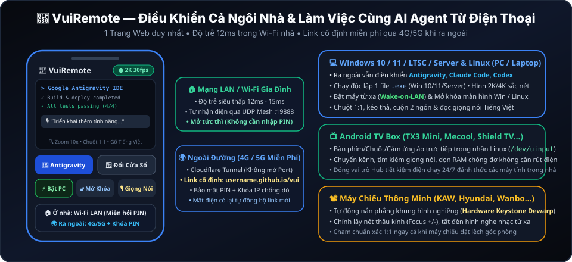
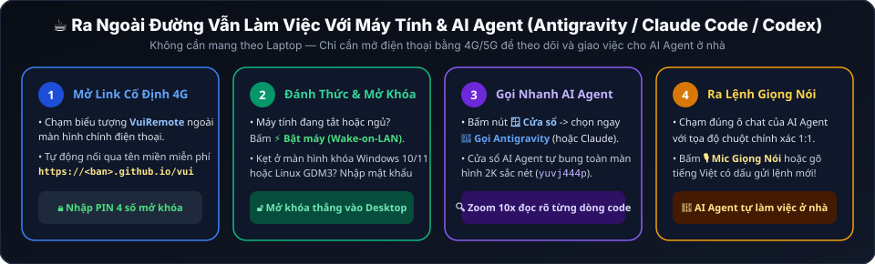
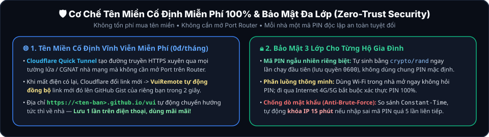

# VuiRemote 📺💻📽️🚀

[](AGENTS.md)
[](#-danh-sách-hệ-điều-hành--thiết-bị-hỗ-trợ)
[](#-danh-sách-hệ-điều-hành--thiết-bị-hỗ-trợ)
[](#️-điều-khiển-qua-internet-4g5g-với-tên-miền-cố-định-miễn-phí-100--bảo-mật-3-lớp)
[](LICENSE)

**VuiRemote** là hệ thống điều khiển từ xa đa thiết bị siêu nhẹ (**Zero-Latency Multi-Device Web Remote Hub**) viết bằng **Go (Golang)** thuần (100% thư viện chuẩn), cho phép điều khiển toàn bộ thiết bị trong gia đình **và làm việc từ xa với các AI Agent (Google Antigravity, Claude Code, OpenAI Codex / Cursor)** chỉ từ **một trang Web duy nhất trên điện thoại**:

<p align="center">
  
</p>

> ⭐ **Nếu thấy VuiRemote hữu ích, hãy tặng dự án 1 ngôi sao (Star) ở góc trên bên phải GitHub để ủng hộ tác giả và giúp nhiều người biết đến hơn nhé!**

---

## 📋 Danh Sách Hệ Điều Hành & Thiết Bị Hỗ Trợ

Bạn không cần cài bất kỳ App nặng nề nào lên điện thoại (iPhone iOS / Android đều mở trực tiếp bằng trình duyệt Safari / Chrome). Ở phía thiết bị được điều khiển, **VuiRemote** hỗ trợ toàn diện:

| Nhóm thiết bị | Hệ điều hành & Phiên bản hỗ trợ cụ thể | Đặc điểm triển khai & Tính năng nổi bật |
| :--- | :--- | :--- |
| 🪟 **Máy tính Windows**<br>*(PC để bàn, Laptop, Mini PC NUC/Beelink, Surface)* | • **Windows 11** *(Home, Pro, Enterprise, IoT / LTSC — 21H2, 22H2, 23H2, 24H2)*<br>• **Windows 10** *(Home, Pro, LTSC — mọi bản 64-bit từ 1809 đến 22H2)*<br>• **Windows 8.1 (64-bit)**<br>• **Windows Server 2016 / 2019 / 2022 / 2025** *(bản có giao diện Desktop)* | • Chạy độc lập **1 file `.exe` duy nhất (`~6.6MB`)**, **không cần cài đặt**, không cần `.NET` hay `VC++` phụ thuộc.<br>• Tự nhận diện tỉ lệ DPI (`100%`–`250%`), màn hình `FullHD / 2K / 4K`, chuyển nhanh cửa sổ **Antigravity / Claude Code** và hỗ trợ **Wake-on-LAN** bật máy từ xa. |
| 🐧 **Máy tính Linux**<br>*(PC, Laptop, Workstation, Mini Server, Raspberry Pi)* | • **Ubuntu** *(20.04, 22.04, 24.04 LTS)* & **Pop!_OS**<br>• **Linux Mint, Debian, Kali Linux, Zorin OS**<br>• **Fedora, RHEL, AlmaLinux, Rocky Linux**<br>• **Arch Linux, Manjaro, EndeavourOS** | • Tích hợp cầu nối **GDM3 Pre-Login Bridge** cho phép nhìn thấy và **nhập mật khẩu mở khóa thẳng từ màn hình khóa Linux**.<br>• Truyền hình ảnh chuẩn màu **`yuvj444p` (4:4:4)** siêu nét không nhòe chữ khi đọc code trên điện thoại. |
| 📺 **Android TV & TV Box**<br>*(Box nhà mạng & Box quốc tế)* | • **Android 5.0 đến Android 14 / Google TV** *(cả chip 32-bit `ARMv7` và 64-bit `ARM64`)*<br>• **Tanix TX3 Mini / TX3 Max, X96, Mecool, H96**<br>• **Viettel TV360 Box, FPT Play Box, MyTV Box**<br>• **Xiaomi Mi Box S, Chromecast, Nvidia Shield, TV Sony/TCL/Casper** | • Khởi tạo thiết bị phần cứng ảo trực tiếp trong nhân Linux (`/dev/uinput`: `VuiTouch`, `VuiMouse`, `VuiKeyboard`) cho tốc độ phản hồi **`12ms`**.<br>• Đóng vai trò **Hub tiết kiệm điện chạy 24/7** để gửi xung **Wake-on-LAN** bật dàn PC Windows/Linux trong nhà. |
| 📽️ **Máy chiếu thông minh**<br>*(Smart Android Projector)* | • **KAW A70 Pro, Hyundai, Wanbo, XGIMI, Beecube, Eroc...** *(chạy Android TV / AOSP)* | • Tự động đọc 4 góc căn chỉnh **Hardware Keystone** và tính ma trận phối cảnh 8 tham số (**Perspective Dewarp**) để nắn thẳng khung hình HDMI nghiêng thành 16:9 phẳng trên điện thoại.<br>• Điều khiển lấy nét thấu kính (**Focus +/-**) và tắt đèn hình nghe nhạc. |

---

## ☕ Ra Ngoài Đường Vẫn Làm Việc Với Máy Tính & AI Agent (Antigravity / Claude Code / Codex)

Bạn đang ngồi cà phê hoặc đi công tác mà không mang theo Laptop, nhưng vẫn muốn kiểm tra tiến độ hoặc giao việc tiếp cho **Google Antigravity**, **Claude Code**, hay **Codex** đang chạy trên máy tính Windows 10/11 hoặc Linux ở nhà?

<p align="center">
  
</p>

1. **Đánh thức & Mở khóa PC từ xa**: Ngay cả khi máy tính ở nhà đang tắt nguồn hoặc ngủ, bạn chỉ cần mở VuiRemote trên điện thoại (qua 4G/5G), chạm **`⚡ Bật máy (Wake-on-LAN)`** và nhập mật khẩu mở khóa màn hình đăng nhập **Windows 10/11 / Linux GDM3**.
2. **Nút bấm chuyên dụng `🪟 Cửa sổ -> 🚀 Gọi Antigravity`**: Không cần mò tìm giữa hàng chục cửa sổ đang mở trên Desktop — chỉ 1 chạm là cửa sổ **Antigravity / IDE** tự động được kích hoạt và bung toàn màn hình.
3. **Hình ảnh 2K/4K sắc nét (`yuvj444p`) + Zoom `10x` + Chuột `1:1`**: Đọc rõ từng dòng code, từng thông báo Terminal trên màn hình điện thoại và bấm chuột chính xác tuyệt đối vào mọi nút bấm nhỏ.
4. **Ra lệnh bằng Giọng nói / Gõ Tiếng Việt có dấu**: Bấm nút **`🎙️ Giọng nói`** trên điện thoại đọc thẳng yêu cầu bằng tiếng Việt để giao việc tiếp cho AI Agent làm việc ở nhà!

---

## 🛡️ Điều Khiển Qua Internet (4G/5G) Với Tên Miền Cố Định Miễn Phí 100% & Bảo Mật 3 Lớp

Khác với các giải pháp phải mua tên miền trả phí hoặc mở Port trên cục phát Wi-Fi (rất nguy hiểm và thường bị nhà mạng chặn CGNAT), **VuiRemote** tích hợp sẵn kiến trúc **Đường truyền miễn phí + Tên miền cố định vĩnh viễn + Bảo mật Zero-Trust**:

<p align="center">
  
</p>

### 1. Làm sao có "Tên miền cố định vĩnh viễn miễn phí" không sợ mất điện?
- **Cloudflare Quick Tunnel (`trycloudflare.com`)**: Tạo đường hầm HTTPS miễn phí xuyên qua mọi tường lửa nhà mạng mà không cần mở Port Router. Tuy nhiên, mỗi lần nhà bạn mất điện hoặc khởi động lại thiết bị, Cloudflare miễn phí sẽ cấp một đường link ngẫu nhiên mới.
- **Tự động đồng bộ sang GitHub Pages (`https://<ten-ban>.github.io/vui`)**:
  - Ngay khi có mạng lại, tiến trình ngầm `syncTunnelURLToGist()` trong VuiRemote tự động phát hiện link `.trycloudflare.com` mới và cập nhật lên **GitHub Gist** của riêng bạn (theo cấu hình mẫu [`configs/vui_gist_sync.example.json`](configs/vui_gist_sync.example.json)).
  - Trang chuyển hướng tĩnh miễn phí trên **GitHub Pages** ([`configs/github_pages_redirect.html`](configs/github_pages_redirect.html)) tại địa chỉ cố định `https://<ten-ban>.github.io/vui` sẽ tự động đọc Gist và **đưa bạn vào thẳng link mới nhất trong 0.5 giây**!
  - Bạn chỉ cần lưu `https://<ten-ban>.github.io/vui` ra màn hình chính điện thoại **1 lần duy nhất và dùng suốt đời**.

### 2. Ai ai cũng dùng mã nguồn mở này thì bảo mật ra sao?
Chúng tôi thiết kế **3 lớp bảo mật tự động** để mỗi gia đình hoàn toàn biệt lập và an toàn tuyệt đối:
1. **Không tồn tại mã PIN mặc định chung**: Ngay lần chạy đầu tiên, VuiRemote sử dụng `crypto/rand` tự động sinh một **mã PIN 4 số ngẫu nhiên độc lập riêng cho máy của bạn** và lưu vào file nội bộ (`~/.config/vuiremote/pin.txt`, quyền `0600` chỉ chủ máy đọc được — tuyệt đối không lưu trên Git).
2. **Phân luồng thông minh (Smart Context-Aware Auth)**:
   - 🏠 **Khi dùng Wi-Fi trong nhà (Mạng LAN nội bộ)**: Mở tức thì không hỏi mã PIN, tiện lợi như chiếc điều khiển cầm tay.
   - 🌍 **Khi đi qua Internet (4G/5G / Cloudflare Tunnel)**: **Bắt buộc 100% phải nhập đúng mã PIN** mới tải được giao diện và gọi API (sử dụng phiên `HttpOnly` ký bằng `SHA-256`).
3. **Chống dò mã PIN (Anti-Brute-Force Lockout)**: Kiểm tra mã PIN bằng thuật toán chống đo thời gian (`crypto/subtle.ConstantTimeCompare`). Nếu một địa chỉ IP bên ngoài nhập sai mã PIN **quá 5 lần**, hệ thống **tự động khóa IP đó trong 15 phút** (`HTTP 429 Too Many Requests`).

---

## 💻 Công Cụ Dòng Lệnh CLI Siêu Gọn (`vuiremote` CLI)

Bên cạnh việc ra lệnh cho AI Agent, bạn có thể kiểm tra nhanh mọi thông số chỉ bằng 1 câu lệnh ngắn trên Terminal / Command Prompt:

```text
$ vuiremote status
╔══════════════════════════════════════════════════════════════════╗
║                 📡 TRẠNG THÁI HỆ THỐNG VUIREMOTE                 ║
╚══════════════════════════════════════════════════════════════════╝
  🏠 Địa chỉ mạng LAN (Wi-Fi)    : http://192.168.1.154:8090 (Miễn hỏi PIN)
  📌 Link Internet Cố định (4G)  : https://<username>.github.io/vui
  🌐 Link Cloudflare Trực tiếp   : https://xxxx-yyyy.trycloudflare.com
  🔑 Mã PIN bảo mật (ngoài 4G)   : 4928 (Chống dò PIN: khóa 15p sau 5 lần sai)
  📂 File cấu hình thiết bị      : ~/.config/vuiremote/devices.json (6 thiết bị)
```

| Lệnh CLI nhanh | Tác dụng |
| :--- | :--- |
| `vuiremote status` | Xem địa chỉ LAN, Link 4G hiện tại, Link cố định GitHub Pages và Mã PIN bảo mật |
| `vuiremote tunnel start` | Tự động bật miễn phí đường truyền Internet 4G/5G (**Cloudflare Quick Tunnel**) chạy ngầm |
| `vuiremote pin` | Xem mã PIN mở khóa từ xa hiện tại của riêng máy bạn |
| `vuiremote pin 6868` | Đổi mã PIN bảo mật sang số bạn tự chọn |
| `vuiremote pin --regen` | Tự động sinh ngẫu nhiên một mã PIN 4 số mới |
| `vuiremote devices` | Liệt kê danh sách toàn bộ thiết bị trong nhà (`PC`, `TV Box`, `Máy chiếu`) |

---

## 🤖 Triển Khai & Vận Hành Tự Động 100% Bằng AI Agent (Antigravity / Claude Code / Codex)

Dự án được thiết kế chuẩn **AI-Agent Native** (tích hợp sẵn [`AGENTS.md`](AGENTS.md), [`CLAUDE.md`](CLAUDE.md) và kỹ năng [`.agents/skills/vuiremote-deploy/SKILL.md`](.agents/skills/vuiremote-deploy/SKILL.md)). Bạn **không cần tự gõ lệnh cài đặt hay sửa code** — chỉ cần mở **Google Antigravity**, **Claude Code**, hoặc **OpenAI Codex / Cursor** trên Windows 10/11 hoặc Linux và dán câu lệnh mẫu:

### Bước 1: Triển khai lần đầu cho nhà bạn
> 💬 **Prompt mẫu triển khai lần đầu:**
> *"Hãy clone dự án `https://github.com/mrtrinhvn/VuiRemote` về máy, đọc kỹ hướng dẫn trong `AGENTS.md` và `.agents/skills/vuiremote-deploy/SKILL.md`, sau đó tự động quét mạng LAN nhà tôi, biên dịch và triển khai VuiRemote cho máy tính này cùng các thiết bị Android TV / Máy chiếu trong nhà."*

### Bước 2: Ra lệnh cho AI Agent mở rộng và tùy biến tiếp bất kỳ lúc nào
- 🌍 **Bật điều khiển 4G/5G kèm tên miền cố định miễn phí (`github.io/vui`):**
  > *"Hãy bật Cloudflare Tunnel cho VuiRemote và thiết lập đồng bộ tự động lên GitHub Gist + GitHub Pages (`vui`) theo mẫu trong thư mục `configs/` để tôi có đường link cố định điều khiển máy tính từ ngoài đường bằng 4G."*
- ➕ **Thêm thiết bị mới vào nhà:**
  > *"Tôi mới cắm thêm một chiếc Android TV Box ở địa chỉ IP `192.168.1.xxx`, hãy nạp VuiRemote vào đó và thêm vào danh sách thiết bị với tên 'TV Phòng Ngủ'."*
- ⚡ **Cấu hình bật máy tính từ xa (Wake-on-LAN):**
  > *"Hãy kiểm tra địa chỉ MAC của chiếc PC Windows 10/11 trong mạng LAN và cập nhật vào `devices.json` để tôi có thể bấm nút Bật máy từ điện thoại khi đi ra ngoài."*
- 🎨 **Tùy biến nút bấm / Thêm ứng dụng mở nhanh:**
  > *"Hãy thêm nút mở nhanh ứng dụng YouTube và Netflix lên thanh công cụ của VuiRemote rồi cập nhật lại cho các thiết bị trong nhà."*

---

## 🛠️ Cấu trúc thư mục

```text
VuiRemote/
├── AGENTS.md                           # Chỉ dẫn tự động cho Antigravity / OpenAI Codex / Cursor
├── CLAUDE.md                           # Chỉ dẫn tự động cho Claude Code
├── .agents/
│   ├── rules/AGENTS.md                 # Quy tắc vận hành tự động cho AI Agent
│   └── skills/vuiremote-deploy/SKILL.md # Quy trình triển khai, bảo mật & khai thác Day-2
├── cmd/vuiremote/
│   ├── main.go                         # Máy chủ Hub, CLI, Zero-Trust PIN Auth, Streamer & Web UI
│   ├── platform_unix.go                # Tích hợp Linux X11, GDM3 Pre-Login & Android uinput
│   └── platform_windows.go             # Tích hợp Windows 10/11/8.1/Server Win32 GDI & SendInput
├── configs/
│   ├── devices.example.json            # Mẫu cấu hình danh sách thiết bị cho nhà mới
│   ├── vui_gist_sync.example.json      # Mẫu đồng bộ link Cloudflare lên GitHub Gist miễn phí
│   ├── github_pages_redirect.html      # Trang chuyển hướng cố định miễn phí trên GitHub Pages
│   └── kaw_a70_user_calibration.ini    # Mẫu cấu hình 4 góc Keystone máy chiếu
├── docs/assets/                        # Hình ảnh minh họa kiến trúc & quy trình điều khiển
├── scripts/
│   ├── build.sh                        # Biên dịch đa nền tảng (ARMv7, ARM64, Linux, Windows)
│   └── install_gdm_bridge.sh           # Cài đặt quyền điều khiển màn hình khóa Linux GDM3
├── LICENSE                             # Giấy phép nguồn mở MIT
├── NOTICE                              # Câu chuyện nguồn gốc hệ sinh thái "Vui"
└── README.md
```

---

## 💡 Câu chuyện tên gọi "VuiRemote" & Tác giả

Nhiều bạn thắc mắc vì sao dự án lại mang chữ **"Vui"** ở đầu (`VuiRemote`, `VuiTools`).
Dự án này ban đầu được xây dựng nội bộ bởi tác giả của [**Vui Ca Hát (`vuicahat.com`)**](https://vuicahat.com) — nền tảng ca hát & xử lý âm thanh Vocal DSP trực tuyến — cùng chuyên trang văn hóa [**Dân Ca Quan Họ (`dancaquanho.com`)**](https://dancaquanho.com) nhằm điều khiển nhanh dàn máy tính phòng thu, máy chiếu và Android TV Box trong gia đình cũng như làm việc từ xa với **Antigravity / AI Agent** chỉ bằng một chiếc điện thoại.

Nhận thấy công cụ này quá tiện lợi khi kết hợp cùng thế hệ AI Agent mới, tác giả quyết định mở toàn bộ mã nguồn dưới giấy phép **MIT License** để mọi người đều có thể tự do sử dụng và tùy biến cho ngôi nhà của mình.

- ⭐ Nếu dự án giúp ích cho bạn, hãy bấm **Star** trên GitHub để lan tỏa dự án!
- 🎶 Ghé thăm [**vuicahat.com**](https://vuicahat.com) và [**dancaquanho.com**](https://dancaquanho.com) nếu bạn yêu thích ca hát và âm nhạc dân tộc.
